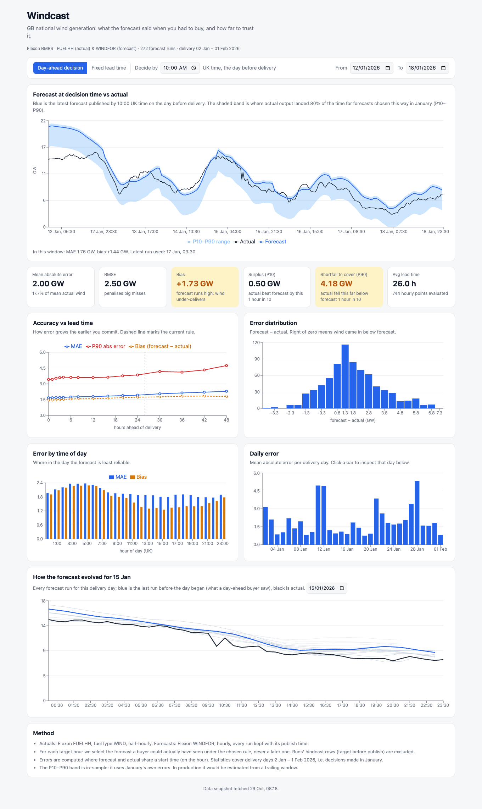

# Windcast — GB wind forecast monitor

A web app for a UK utility's day-ahead trading desk. It answers two questions for
January 2026 using Elexon BMRS data:

1. **What did the wind forecast say when we had to buy?** For any delivery window,
   it shows the forecast that was actually available at decision time, next to the
   wind that was generated.
2. **How much should we trust it?** It measures forecast error (MAE, RMSE, bias,
   P10/P90) and shows how that error changes with lead time, time of day and day.

**Live app:** https://vqmzk.vercel.app



## Key findings (January 2026, day-ahead rule: latest forecast by 10:00 on D-1)

| Metric | Value |
|---|---|
| Mean absolute error | 2.00 GW (17.7% of mean actual wind) |
| Bias (forecast − actual) | **+1.73 GW**: the forecast ran high nearly all month |
| Actual fell short of forecast by more than… | 4.18 GW one hour in ten (P90) |
| Error growth with lead time | MAE 1.68 GW at 0 h → 1.93 GW at 24 h → 2.30 GW at 48 h |

The large positive bias is the main takeaway. Most of the error is not random noise.
WINDFOR consistently over-states metered output. A likely cause, not verified here, is
that metered actuals reflect curtailment and constraint actions that the forecast does
not model. For a buyer, the practical point is: **don't treat the forecast as the
expected value.** Plan to cover the gap with thermal or other procurement, and use
the P90 shortfall as a reserve sizing figure.

## How forecasts are selected

Every WINDFOR run is stored with its `publishTime`. For each target time T, the app
picks the latest run a buyer could have seen:

- **Day-ahead decision** (default): latest run published at or before a cutoff on
  the day before delivery (default 10:00 UK time, adjustable).
- **Fixed lead time:** latest run published at or before `T − h` (h = 0–48 h).

Rows where `startTime < publishTime` are hindcasts, so they are dropped. Forecasts are hourly and
actuals are half-hourly, so errors are computed on matching start times only. The
evaluation window is delivery days 2 Jan – 1 Feb 2026, which are the deliveries
for decisions made in January. The P10–P90 band uses January's own errors, so it
is in-sample. In production you'd fit it on a trailing window.

## Architecture

```
React (Vite, TS, Recharts)  ──fetch /api/*──▶  FastAPI (Python)  ──▶  analysis.py (numpy)
                                                    │
                                    data/wind_jan2026.json.gz  ◀── scripts/fetch_data.py ◀── Elexon BMRS API
```

- January 2026 is history, so the data is fetched once by a script and committed as
  a 110 KB gzipped snapshot. The app starts instantly and needs no Elexon calls at
  runtime. Run the script again to refresh the snapshot.
- On load, forecasts are indexed by target time, with runs sorted by publish time.
  Each "latest forecast before cutoff" lookup is a binary search.
- The API is stateless and read-only, so it fits serverless (Vercel) and a single
  container (Docker) equally well. In Docker, FastAPI also serves the built frontend.

## Repository layout

| Path | What it is |
|---|---|
| `backend/app/elexon.py` | Client for the Elexon FUELHH and WINDFOR stream endpoints |
| `backend/app/analysis.py` | Forecast selection rules and error statistics (pure functions) |
| `backend/app/main.py` | FastAPI routes: `/api/meta`, `/series`, `/metrics`, `/horizon-curve`, `/evolution` |
| `backend/data/` | Committed January 2026 data snapshot |
| `backend/tests/` | pytest unit tests for selection rules and statistics |
| `scripts/fetch_data.py` | Downloads the snapshot from Elexon |
| `frontend/src/App.tsx` | Dashboard layout, controls and data fetching |
| `frontend/src/charts.tsx` | Recharts components |
| `frontend/src/api.ts` | Typed API client |
| `api/index.py` | Vercel serverless entrypoint wrapping the FastAPI app |
| `e2e/` | Playwright end-to-end tests (run in Brave) |
| `Dockerfile`, `docker-compose.yml` | Single-container build: frontend + API |
| `vercel.json` | Vercel build and routing config |

## Running it

**Docker (simplest):**

```bash
docker compose up --build
```

Then open http://localhost:8000.

**Local dev** (needs Python 3.11+ with [uv](https://docs.astral.sh/uv/), and Node 20+):

```bash
cd backend && uv sync && uv run uvicorn app.main:app --reload --port 8000
cd frontend && npm install && npm run dev       # http://localhost:5173, proxies /api to :8000
```

**Tests:**

```bash
cd backend && uv run pytest                     # unit tests
cd frontend && npm run build                    # needed once: the API serves frontend/dist
cd e2e && npm install && npx playwright test    # E2E against http://localhost:8000
```

The E2E suite launches Brave by default. Set `BROWSER_PATH` to use another Chromium-based browser.

**Refresh data:** `uv run --project backend python scripts/fetch_data.py`

**Deploy:** `vercel --prod` from the repo root. `vercel.json` builds the frontend
and deploys `api/index.py` as a Python function.

## AI tools

This project was built with help from Claude Code (Anthropic), which was used for
scaffolding, implementation, tests and documentation.
